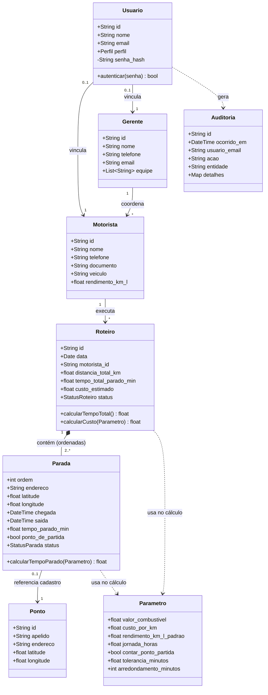
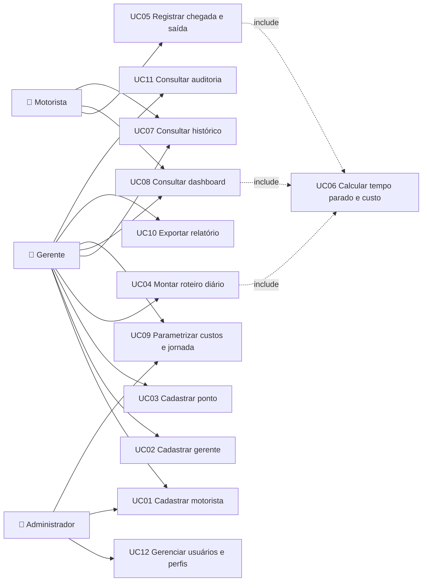
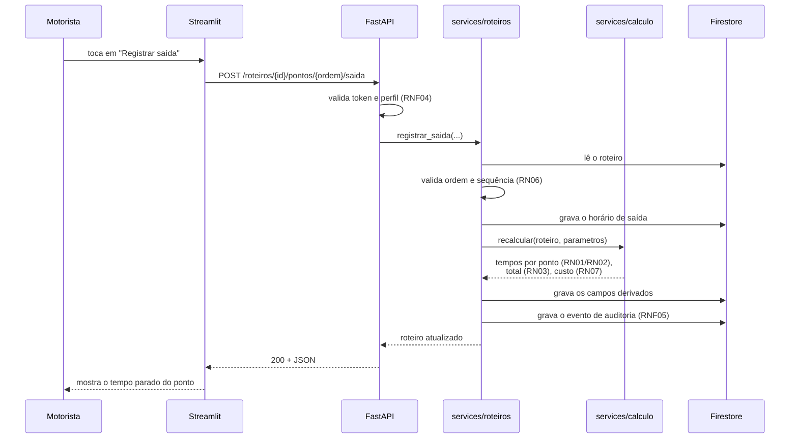

# Modelo conceitual, casos de uso e arquitetura

Complemento técnico do que foi construído na 2ª parte do trabalho. A
especificação da 1ª parte (casos de uso, diagramas de robustez e classes
conceitual) continua sendo o documento oficial; aqui está o recorte do que o
código realmente implementa.

---

## Arquitetura

```
┌──────────────────────────┐        HTTP/JSON        ┌──────────────────────────┐
│   Front-end (Streamlit)  │  ────────────────────▶  │   Back-end (FastAPI)     │
│                          │  ◀────────────────────  │                          │
│  Dashboard · Registro    │      Bearer token       │  routers → services →    │
│  Histórico · Cadastros   │                         │  repositories            │
│  Configurações · Admin   │                         │                          │
└──────────────────────────┘                         └────────────┬─────────────┘
                                                                  │ firebase-admin
                                                                  ▼
                                                     ┌──────────────────────────┐
                                                     │   Cloud Firestore        │
                                                     │   (Firebase)             │
                                                     └──────────────────────────┘
```

As camadas do back-end:

| Camada | Responsabilidade | Onde |
|---|---|---|
| **Routers** | Contrato HTTP, validação de entrada, autorização por perfil | `app/routers/` |
| **Services** | Regras de negócio (RN01–RN07), orquestração, auditoria | `app/services/` |
| **Repositories** | Acesso às coleções, sem regra de negócio | `app/repositories.py` |
| **Store** | Contrato de persistência; implementação Firestore | `app/core/store.py`, `app/core/firebase.py` |

A interface `DocumentStore` isola o Firestore do resto do código. Isso é o que
permite rodar os 31 testes sem tocar em um banco real, e trocar de banco no
futuro mexendo em um arquivo só.

---

## Modelo de classes conceitual



### Por que `Parada` é diferente de `Ponto`

- **Ponto** é o cadastro do endereço (RF03): existe uma vez e é reaproveitado.
- **Parada** é a passagem por aquele endereço em um roteiro específico: tem
  ordem, chegada, saída e tempo parado.

O mesmo endereço pode ser parada de dezenas de roteiros, cada uma com o seu
próprio tempo — é isso que permite o ranking "onde mais se perde tempo" no
dashboard.

---

## Casos de uso implementados



| UC | Nome | Ator | Requisitos |
|---|---|---|---|
| UC01 | Cadastrar motorista | Gerente, Admin | RF01 |
| UC02 | Cadastrar gerente | Gerente, Admin | RF02 |
| UC03 | Cadastrar ponto | Gerente, Admin | RF03 |
| UC04 | Montar roteiro diário | Gerente, Admin | RF04, RN05, RN06 |
| UC05 | Registrar chegada e saída | Motorista | RF05, RN02 |
| UC06 | Calcular tempo parado e custo | *(incluído)* | RF06, RF11, RN01, RN03, RN07 |
| UC07 | Consultar histórico | todos | RF07 |
| UC08 | Consultar dashboard | todos | RF08, RN04 |
| UC09 | Parametrizar custos e jornada | Gerente, Admin | RF09, RF10 |
| UC10 | Exportar relatório | todos | RF12 |
| UC11 | Consultar auditoria | Gerente, Admin | RNF05 |
| UC12 | Gerenciar usuários e perfis | Admin | RNF04 |

---

## Fluxo principal: registrar uma parada (UC05 + UC06)



O ponto importante: **o tempo parado nunca é enviado pelo cliente**. O
front-end só manda "cheguei" e "saí"; o cálculo é sempre do servidor, a partir
dos parâmetros vigentes.

---

## Coleções no Firestore

| Coleção | Documento | Campos principais |
|---|---|---|
| `motoristas` | id gerado | `nome`, `telefone`, `documento`, `veiculo`, `rendimento_km_l`, `ativo` |
| `gerentes` | id gerado | `nome`, `telefone`, `email`, `equipe[]`, `ativo` |
| `pontos` | id gerado | `apelido`, `endereco`, `latitude`, `longitude` |
| `roteiros` | id gerado | `data` (`YYYY-MM-DD`), `motorista_id`, `distancia_total_km`, `pontos[]`, `tempo_total_parado_min`, `percentual_jornada`, `custo_estimado`, `custo_detalhado`, `status`, `criado_em`, `atualizado_em` |
| `parametros` | `global` | `valor_combustivel`, `custo_por_km`, `rendimento_km_l_padrao`, `jornada_horas`, `contar_ponto_partida`, `tolerancia_minutos`, `arredondamento_minutos` |
| `usuarios` | id gerado | `nome`, `email`, `perfil`, `senha_hash`, `motorista_id`, `gerente_id`, `ativo` |
| `auditoria` | id gerado | `ocorrido_em`, `usuario_email`, `perfil`, `acao`, `entidade`, `entidade_id`, `detalhes` |

**Convenção de tipos:** datas são gravadas como `YYYY-MM-DD` e instantes como
ISO-8601 com fuso. Strings nesse formato são ordenáveis e comparáveis, então as
consultas por faixa de data funcionam direto no Firestore, sem conversão.

### Índices compostos

Declarados em `firestore.indexes.json`:

| Coleção | Campos | Usado por |
|---|---|---|
| `roteiros` | `motorista_id` ASC, `data` ASC | dashboard e histórico filtrados por motorista |
| `auditoria` | `entidade` ASC, `ocorrido_em` DESC | trilha por tipo de entidade |
| `auditoria` | `entidade` ASC, `entidade_id` ASC, `ocorrido_em` DESC | trilha de um roteiro específico |

---

## Segurança

- **Autenticação:** token assinado com HMAC-SHA256 e prazo de validade
  configurável (`TOKEN_EXPIRACAO_HORAS`).
- **Senhas:** PBKDF2-HMAC-SHA256 com 120 mil iterações e salt por usuário.
  Nunca voltam em nenhuma resposta da API.
- **Autorização:** dependência `requer_perfil` em cada rota. O motorista só
  acessa os próprios roteiros — verificado também dentro do serviço, não apenas
  na rota.
- **Banco:** `firestore.rules` nega qualquer acesso direto de cliente. Só o
  Admin SDK, que roda dentro do back-end, escreve no Firestore.
- **Credenciais:** o service account fica fora do Git (`.gitignore`).
